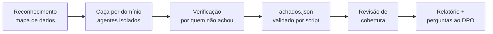

<p align="center">
  
</p>

<h1 align="center">lgpd-dpo</h1>

<p align="center">
  <strong>A LGPD dentro do seu agente de código.</strong><br>
  Auditoria de privacidade com evidência em <code>arquivo:linha</code> e playbooks do encarregado (DPO),<br>
  para organizações brasileiras de qualquer setor.
</p>

<p align="center">
  <a href="https://github.com/pedrogiru/lgpd-dpo-skill/actions/workflows/ci.yml"></a>
  <a href="LICENSE"></a>
  
  <a href="evals/RESULTADOS.md"></a>
  
</p>

<p align="center">
  <a href="#instalação">Instalação</a> ·
  <a href="#veja-funcionando">Exemplos</a> ·
  <a href="#o-que-ela-cobre">Cobertura</a> ·
  <a href="#qualidade-medida">Evals</a> ·
  <a href="#perguntas-frequentes">FAQ</a> ·
  <a href="#english-summary">English</a>
</p>

---

Peça ao seu agente *"essa mudança tem problema de LGPD?"* ou *"tivemos um vazamento, qual o prazo?"*.
Com a `lgpd-dpo`, ele responde com o artigo certo, separa o que o código prova do que depende de
decisão da empresa e não inventa conformidade.

> [!IMPORTANT]
> **Não é parecer jurídico nem declaração de conformidade.** A skill produz evidência técnica e
> rascunhos. Decisões sobre base legal, comunicação de incidente e aceitação de risco são do
> controlador, com o encarregado e o jurídico. Versão 0.1: o conteúdo normativo ainda não passou por
> revisão jurídica identificada.

## Por que ela é diferente

- **Evidência, não checklist.** Todo achado traz:
  - titular;
  - dado;
  - obrigação violada;
  - resultado concreto;
  - fluxo com `arquivo:linha`.

  "Falta boa prática" não vira achado.
- **Sabe o que o código não prova.** Base legal, contratos, porte e região de nuvem não estão no
  repositório. Esses pontos viram `precisa_validacao`, com a pergunta exata para o DPO, o jurídico
  ou a infra.
- **Quem confere não é quem achou.** Na auditoria completa, cada candidato vai a um verificador
  novo, que tenta derrubá-lo.
- **Normas conferidas e datadas.** Os pontos que os modelos mais erram de memória estão fixados no
  `SKILL.md`. Exemplos: art. 11, §4; adequação da UE pela Res. CD/ANPD nº 32/2026; RIPD; art. 20;
  incidentes. Cada norma tem situação e data de verificação.
- **Não vaza o que audita.** Regras fixas contra copiar dado pessoal real para relatórios, e um
  validador que reprova CPF, CNPJ, e-mail e telefone reais.
- **Medida, não prometida.** A skill vem com uma suíte de evals pública e o resultado de cada
  rodada, inclusive quando ela perde.

## Instalação

**Qualquer agente** (Claude Code, Codex, Cursor, Gemini CLI, OpenCode e outros), com o
[Skills CLI](https://github.com/vercel-labs/skills):

```bash
npx skills add pedrogiru/lgpd-dpo-skill
```

Use `-g` para instalar para o seu usuário em vez do projeto.

**Claude Code, como plugin** (atualizações pelo menu `/plugin`):

```text
/plugin marketplace add pedrogiru/lgpd-dpo-skill
/plugin install lgpd-dpo@lgpd-dpo
```

**Manual:**

```bash
git clone https://github.com/pedrogiru/lgpd-dpo-skill
ln -s "$PWD/lgpd-dpo-skill/skills/lgpd-dpo" ~/.claude/skills/lgpd-dpo
```

Requisito: Node.js, para os scripts de validação. Eles não têm dependências, não acessam a rede e
não têm telemetria. Custo em contexto: cerca de 240 tokens por sessão e cerca de 3,3 mil quando a
skill é acionada.

## Como usar

Fale normalmente. A skill é acionada sozinha quando o assunto é LGPD.

| Você pede | O que acontece |
|---|---|
| "Essa mudança tem algum problema de LGPD?" | Revisão focada, resposta na conversa |
| "O formulário pode pedir CPF?" | Hipóteses legais e o que depende da empresa, sem "pode/não pode" |
| "Faz uma auditoria completa de LGPD neste repositório." | Fluxo de 6 fases, relatório fora do repositório |
| "Tivemos um vazamento ontem, qual o prazo e o que comunicar?" | Prazos com a data final, conteúdo da comunicação à ANPD e aos titulares |
| "Um cliente pediu para apagar todos os dados dele." | O que eliminar, o que tem guarda legal e o modelo de resposta |
| "Monta o RIPD do novo app." / "Avalia este fornecedor." | Rascunho com `[A PREENCHER]` onde só a empresa sabe |

## Veja funcionando

Saídas reais da v0.1.1, sem edição, em cenários fictícios dos evals:

- **[Revisão de um checkout de e-commerce](docs/exemplos/revisao-ecommerce.md)**:
  - CPF em log e em URL;
  - consentimento pré-marcado;
  - Conversions API da Meta com hash sem segredo;
  - o que ficou como `precisa_validacao`.
- **[Prazo de incidente](docs/exemplos/incidente-prazo.md)**: conta os dias úteis pulando o feriado
  de 20/11, lista os 12 itens da comunicação à ANPD e avalia o prazo em dobro.

Trecho da revisão do checkout:

```markdown
| # | Achado | Risco | Onde |
|---|---|---|---|
| 1 | O corpo inteiro do checkout vai para o log | Médio | `checkout.ts:13`, `logger.ts:3-5` |
| 2 | CPF completo na URL do rastreio e no log de acesso | Médio | `pedidos.ts:8-10`, `rastreio.ts:2`, `server.ts:12-13` |
| 3 | Checkbox de marketing já vem marcado, sem registro do consentimento | Médio | `CheckoutForm.tsx:21`, `checkout.ts:22-27` |

**1. O corpo do checkout vai inteiro para o log.**
- `logger.info({ body: req.body }, ...)` grava nome, e-mail, CPF, telefone e endereço em `logs/app.log`.
- Esses logs ficam 90 dias e são lidos por toda a engenharia e pelo suporte N2.
- Isso fere a necessidade e a segurança (LGPD, art. 6º, III e VII, e art. 46).
```

## O que ela cobre

<table>
<tr><td valign="top" width="50%">

**Auditoria de código e sistemas**
- Mapa de dados com dicionário de campos multissetorial
- Necessidade e finalidade
- Base legal e consentimento
- Crianças, adolescentes e ECA Digital
- Segurança: logs, URLs, acesso, exposição
- Retenção, eliminação e guarda legal
- Direitos do titular e art. 20
- Pixels, conversões server-side, cookies, WhatsApp, CRM
- IA: prompts, embeddings, decisões automatizadas
- Transferência internacional
- Setor de saúde (outros setores no roadmap)

</td><td valign="top" width="50%">

**Encarregado (DPO)**
- Incidentes (Res. CD/ANPD nº 15/2024): critérios, prazos, 12 itens da comunicação, aviso ao
  titular, registro
- Requisições de titulares (arts. 18 a 20)
- RoPA (art. 37) e RIPD com o critério de alto risco da Res. CD/ANPD nº 2/2022
- Teste de legítimo interesse
- Fornecedores, contrato de operador e transferência internacional (Res. 19/2024 e 32/2026)
- Aviso de privacidade

</td></tr>
</table>

### Como a auditoria completa funciona



Cada registro termina em um de quatro vereditos:
- `confirmado` (com nível de risco ao titular);
- `precisa_validacao` (com responsável e plano);
- `observacao`;
- `rejeitado`.

Sem agentes paralelos, as fases rodam em sequência, e o relatório diz isso.

## Qualidade medida

A pasta [`evals/`](evals/) tem 15 casos públicos: 3 auditorias de código, 2 entregáveis de DPO e 10
regressões normativas. Eles incluem armadilhas para medir falso positivo, um script de execução e
outro de pontuação.

| Sonnet, 24/10/2026 (n=1) | Casos | Critérios | Armadilhas violadas | Skill acionada |
|---|---|---|---|---|
| Sem skill | 12/15 | 77/80 | 0 | — |
| **lgpd-dpo 0.1.1** | **15/15** | **80/80** | **0** | 14/15 |

As respostas brutas estão em [`evals/resultados/`](evals/resultados/). Leia as
[ressalvas](evals/RESULTADOS.md#ressalvas) antes de citar: uma execução por caso, um modelo
e um gabarito ainda sem revisão jurídica. A próxima rodada compara também com outras skills de LGPD
e usa casos reservados, escritos por terceiros.

## Perguntas frequentes

<details>
<summary><strong>Ela diz se minha empresa está em conformidade?</strong></summary>

Não, e de propósito. Conformidade depende de fatos que nenhum código mostra e de decisão jurídica.
A skill aponta problemas com evidência, diz o que precisa ser confirmado e por quem, e nunca dá nota,
selo nem valor de multa.
</details>

<details>
<summary><strong>Ela manda meu código ou meus dados para algum lugar?</strong></summary>

A skill é só instrução e scripts locais. O que sai da sua máquina é o que o seu agente já envia ao
provedor de modelo que você usa. As instruções proíbem acessar produção e copiar dado pessoal real
para relatórios.
</details>

<details>
<summary><strong>Serve para o meu setor?</strong></summary>

O núcleo vale para qualquer organização. Saúde já tem arquivo próprio; financeiro, varejo, educação e
setor público estão no roadmap. Até lá, conclusões que dependem de norma setorial (BACEN, SUSEP,
ANATEL, MEC, legislação trabalhista) saem como `precisa_validacao`, em vez de chute.
</details>

<details>
<summary><strong>E se a ANPD mudar uma regra?</strong></summary>

Cada norma tem situação e data de verificação em
[`normas/referencias.md`](skills/lgpd-dpo/normas/referencias.md), e a skill manda conferir a fonte
oficial antes de cravar prazos. Viu algo desatualizado? Abra uma
[errata normativa](.github/ISSUE_TEMPLATE/errata-normativa.md).
</details>

<details>
<summary><strong>Funciona sem o Claude Code?</strong></summary>

Sim. O formato `SKILL.md` é lido por vários agentes, e as instruções não dependem de ferramentas de um
produto específico. Os evals publicados até agora rodaram no Claude Code; resultados em outros agentes
são bem-vindos.
</details>

## Roadmap

- **v0.2**:
  - evals com juiz cego, 3 execuções por caso e respostas publicadas;
  - teste de ponta a ponta da auditoria completa;
  - validador de cobertura e calculadora de prazos;
  - pacote para o Claude.ai.
- **v0.3**: domínios de RH e colaboradores, crianças e ECA Digital, biometria.
- **v0.4**: setores financeiro, varejo, educação e setor público, cada um com eval.
- **v0.5**: modelos de documentos, modo de DPO sem código, relatório gerado por script.
- **v1.0**: benchmark contra outras skills, revisão jurídica identificada, testes em 5 agentes.

Detalhes em [docs/roadmap.md](docs/roadmap.md).

## Contribuindo

Errata jurídica tem prioridade sobre qualquer funcionalidade. Advogados e DPOs que queiram revisar
são muito bem-vindos. Veja [CONTRIBUTING.md](CONTRIBUTING.md). Para desenvolver:

```bash
node --test tests/*.test.cjs     # scripts
node evals/score.cjs --check     # consistência dos evals
evals/rodar.sh com sonnet /tmp/respostas && node evals/score.cjs --all /tmp/respostas
```

## Licença

[MIT](LICENSE). Segurança: [SECURITY.md](SECURITY.md). Conduta: [CODE_OF_CONDUCT.md](CODE_OF_CONDUCT.md).

---

## English summary

**lgpd-dpo** is an agent skill for auditing software against **Brazil's General Data Protection Law
(LGPD, Lei 13.709/2018)** and for supporting the work of a **Data Protection Officer
(encarregado)**, in any sector.

It maps personal data flows and reports issues with `file:line` evidence. It keeps what the code
proves (`confirmado`) apart from what depends on the controller's own facts
(`precisa_validacao`), and in full audits it sends every candidate to an independent verifier. A
dependency-free script validates the output.

It also ships playbooks for:
- incident notification under ANPD Resolution 15/2024;
- data subject requests;
- RoPA and DPIA (RIPD);
- legitimate interest assessments;
- vendor due diligence and international transfers.

The content is in Brazilian Portuguese. The skill is not legal advice and never declares compliance.

```bash
npx skills add pedrogiru/lgpd-dpo-skill
```
